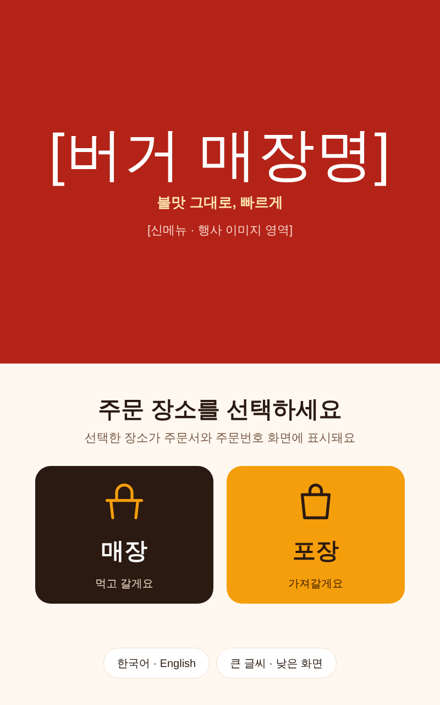
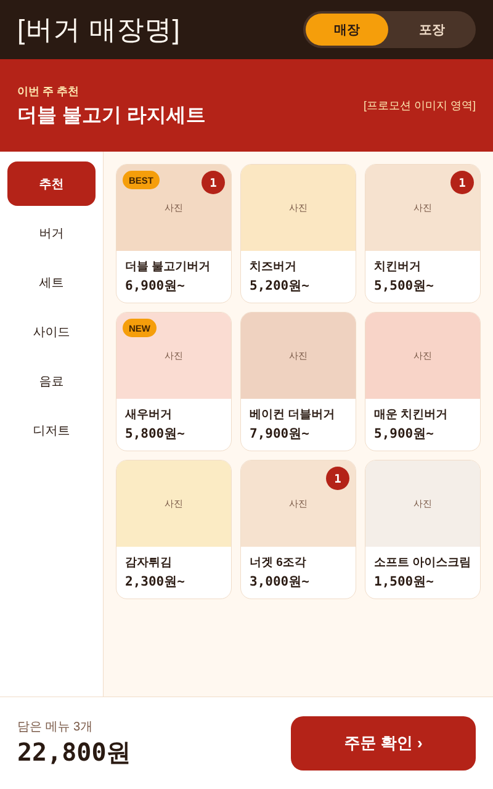
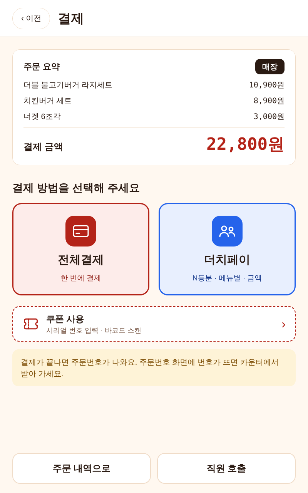
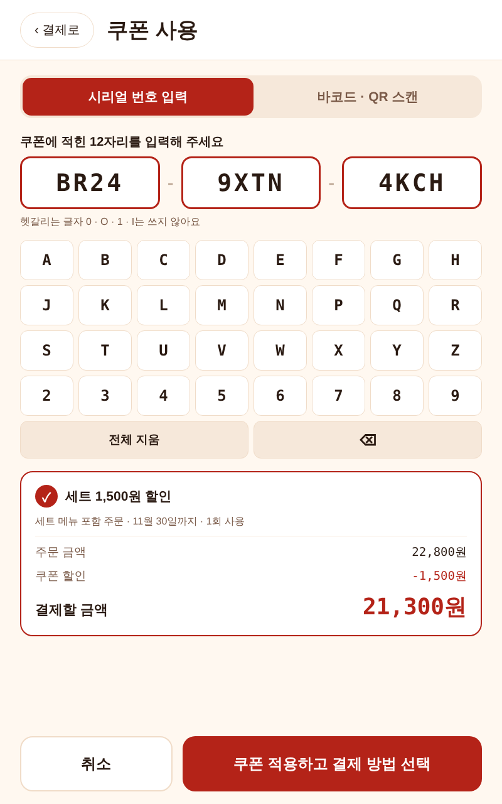
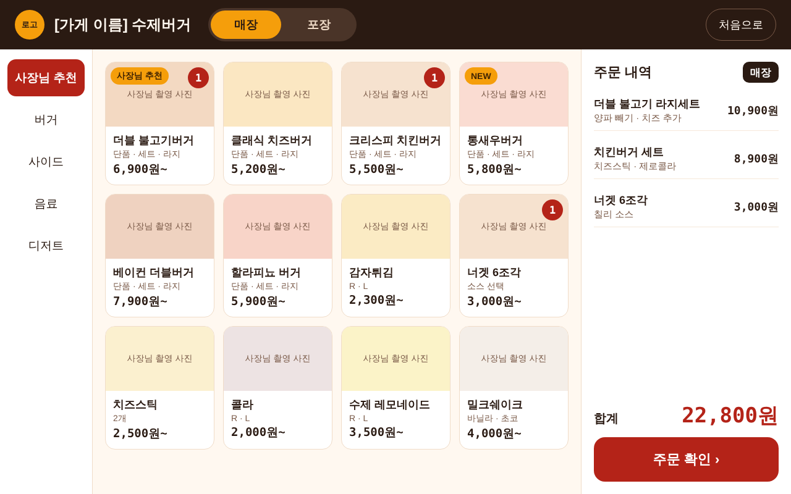
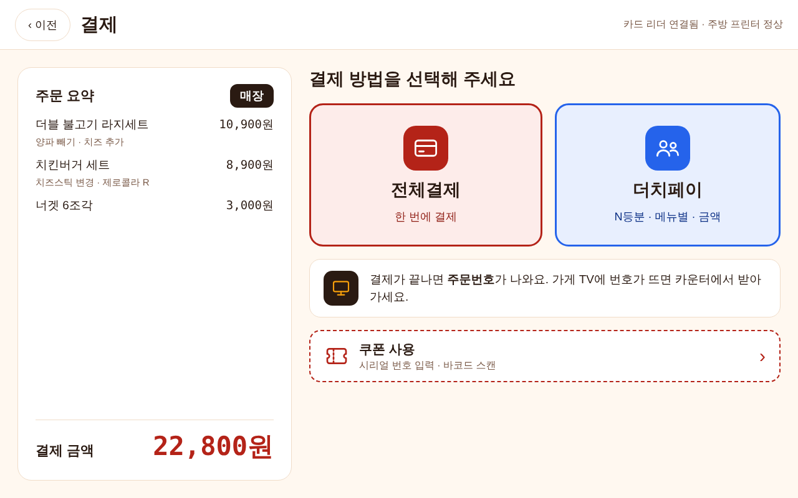
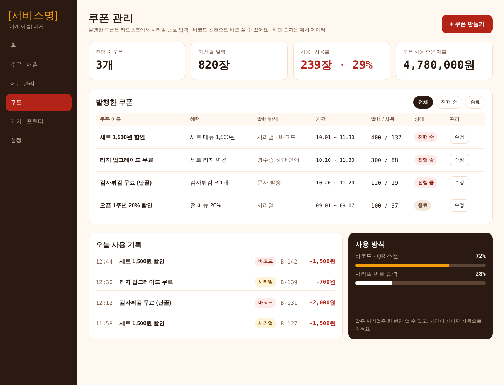
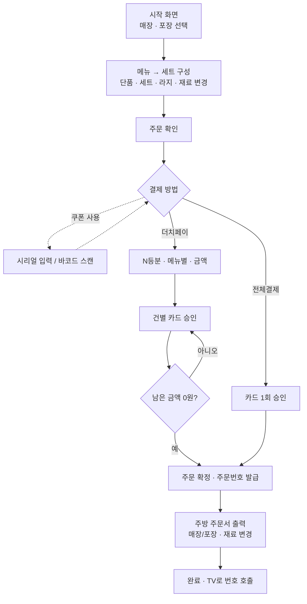
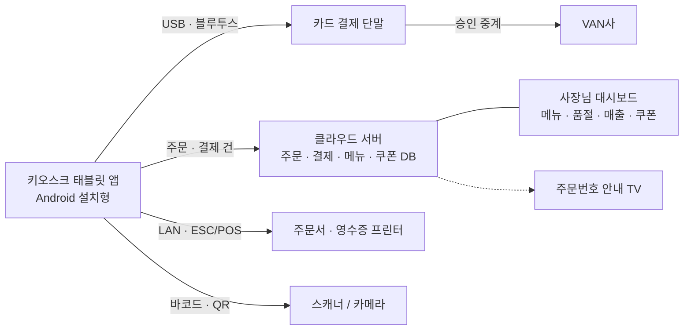

# 태블릿 키오스크 — 버거 (버거킹 벤치마킹)

버거킹 주문 흐름을 벤치마킹한 개인 버거집용 태블릿 키오스크 디자인안입니다. 단품 · 세트 · 라지세트 구성, 재료 변경, 주문번호 TV 호출, N등분 더치페이, 사장님 쿠폰 발행까지 담았습니다.

- **하드웨어 설치형**: 잠금 스탠드 + 카드 단말 + 프린터 일체형 세로 키오스크 (800×1280)
- **소프트웨어 설치형**: 사장님이 가진 갤럭시탭에 앱만 설치하는 가로 키오스크 (1280×800) — 프랜차이즈가 아닌 개인 사업자 대상
- 두 방식 모두 **같은 서버 · 같은 관리자 화면 · 같은 주문 데이터**를 쓰고 매장 기기만 다릅니다.
- 총 31개 화면 · 스탠드형과 갤럭시탭 손님 화면은 각 8장으로 같은 수

## 개발 지침

이 저장소는 **설계서**입니다. 실제 코드는 [tablet-kiosk-core](https://github.com/DevOps0906/tablet-kiosk-core)의 `apps/kiosk/lib/verticals/burger/`에 작성합니다. (앱은 하나, 업종은 모듈)

| 문서 | 내용 |
|---|---|
| [CLAUDE.md](CLAUDE.md) | Claude Code 작업 규칙 — 설계서 사용법, 문서 우선순위 |
| [PRD.md](PRD.md) | 버거 범위 · 예시 주문 · 성공 지표 |
| [DESIGN.md](DESIGN.md) | 버거 테마 토큰 · 화면 목록 · 전용 컴포넌트 · 디자인과 명세 차이 |
| [docs/01-vertical-rules.md](docs/01-vertical-rules.md) | 버거 업무 규칙 · 확장 지점 구현 · 데이터 키 |
| [docs/02-menu-seed.md](docs/02-menu-seed.md) | 예시 메뉴 · 옵션 · 쿠폰 (시드 데이터 기준) |
| [specs/customer-flow.md](specs/customer-flow.md) | 손님 화면 명세 · 수용 시나리오 |
| [specs/owner-setup.md](specs/owner-setup.md) | 사장님 세팅 5단계 명세 |
| [specs/coupon.md](specs/coupon.md) | 쿠폰 발행 · 사용 명세 |
| [tasks/README.md](tasks/README.md) | 관련 core 작업 · 완료 체크리스트 |

### PC에서 개발 시작하기

1. **폴더 하나에 core 와 이 저장소를 나란히 클론**합니다. 이 저장소를 core **안에** 클론하지 않습니다 (저장소 안의 저장소 → git 꼬임).

   ```
   kiosk/
   ├── tablet-kiosk-core/          ← 실제 코드 · 멀티에이전트 팀 (여기서 Claude Code 실행)
   └── tablet-kiosk-burger/    ← 이 저장소 (버거 설계서)
   ```

   ```bash
   mkdir kiosk && cd kiosk
   git clone https://github.com/DevOps0906/tablet-kiosk-core
   git clone https://github.com/DevOps0906/tablet-kiosk-burger
   ```

2. **VS Code로 `kiosk/` 폴더를 엽니다.** (Android Studio는 SDK · 에뮬레이터용으로 설치만)
3. **VS Code 터미널에서 core 를 기준으로 Claude Code 를 실행**하고 이 저장소를 함께 엽니다.

   ```bash
   cd tablet-kiosk-core
   claude --add-dir ../tablet-kiosk-burger
   ```

4. Claude Code 안에서 처음 한 번 `/agent-check`로 팀을 확인하고, `/next-task`로 진행합니다.

| 항목 | 내용 |
|---|---|
| 앱 구조 | Flutter 키오스크 앱(`apps/kiosk`) + Next.js 사장님 대시보드(`apps/admin`) + Supabase — 모두 core 에 있음 |
| 멀티에이전트 | core 의 `.claude/agents/`에 한 번만 들어 있음 (팀장 Opus · 고문 Fable · 대리 Sonnet · 사원 Haiku · 분야 3 · 검증 5). 이 저장소에는 넣지 않음 — [core docs/11](https://github.com/DevOps0906/tablet-kiosk-core/blob/master/docs/11-multi-agent.md) |
| 버거 작업 시점 | task-024 (Phase 6) — 공통 기반 · 결제 · 쿠폰(001–022)이 먼저 끝나야 합니다 |

## 미리보기

| 스탠드형 시작 | 스탠드형 메뉴 | 결제 방법 · 쿠폰 | 쿠폰 시리얼 입력 |
|---|---|---|---|
|  |  |  |  |

| 갤럭시탭 메뉴 | 갤럭시탭 결제 |
|---|---|
|  |  |

| 사장님 쿠폰 대시보드 (반응형) |
|---|
|  |

## 핵심 기능

### 공통
- **매장 / 포장 선택**: 시작 화면에서 고르고, 메뉴 화면 상단 탭에 선택 상태 표시 → 주문서 · 영수증에 `매장` / `포장`을 크게 인쇄
- **전체결제 / 더치페이**: 결제 방법 화면에서 좌우 버튼으로 선택
  - 더치페이 방식: N등분 · 메뉴별 · 금액 지정
  - 결제 건마다 카드 승인 후 서버 저장, 남은 금액이 0원이 될 때까지 반복
  - 시작 후 중간 취소 불가, 실패한 건만 다시 결제
- **주문서 자동 출력**: 결제 완료 즉시 주방 프린터(LAN · ESC/POS) + 카운터 영수증, 출력 실패 시 재시도 큐로 재전송
- **쿠폰 사용**: 시리얼 번호 입력 또는 바코드 · QR 스캔 (아래 쿠폰 시스템 참고)
- **사장님 세팅 5단계 (소프트웨어형)**: 사장님 시작 → 매장 정보 → 메뉴 등록 → 결제 단말 · 프린터 연결 → 키오스크 모드(화면 고정)

### 버거 전용
- **세트 구성**: 단품 · 세트 · 라지세트 선택, 세트면 사이드 · 음료 단계 필수, 라지 업그레이드 추가금 표시
- **재료 변경**: 재료 빼기 무료 · 추가는 유료, 품절 사이드 자동 숨김
- **주문번호**: 매일 001번부터 발급, 주문서 · 영수증 · TV 화면에 같은 번호, 조리 완료 시 TV로 호출
- **주방 주문서**: 매장/포장 · 재료 변경 내역 인쇄
- **예시 주문**: 더블 불고기버거 라지세트 10,900 · 치킨버거 세트 8,900 · 너겟 6조각 3,000 = **22,800원** → 쿠폰 `세트 1,500원 할인` 적용 시 **21,300원**

### 쿠폰 시스템 (사장님 발행 + 손님 사용)

**사장님 (반응형 대시보드)**
- 쿠폰 관리 대시보드: 진행 중 쿠폰 수, 이번 달 발행, 사용 수 · 사용률, 쿠폰 사용 주문 매출, 발행 목록(전체 · 진행 중 · 종료), 오늘 사용 기록, 사용 방식 비율(바코드 · 시리얼)
- 쿠폰 발행: 혜택 종류(금액 할인 · % 할인 · 메뉴 무료 · 1+1), 할인 금액 · 사용 조건, 사용 기간, 발행 수량, 1장당 사용 횟수, 사용 대상(매장 · 포장 · 메뉴 범위)
- 발행 방식(여러 개 선택): 시리얼 번호 자동 생성(엑셀 다운로드) · 바코드 · QR 이미지(인쇄용 PDF) · 문자 발송 · 영수증 하단 인쇄
- 손님이 받는 쿠폰 미리보기 (가게 이름 · 혜택 · 기간 · 바코드 · 시리얼)

**손님 (키오스크)**
- 결제 방법 화면의 `쿠폰 사용` 버튼 → 시리얼 입력 / 바코드 · QR 스캔 탭
- 시리얼: 12자리 (`XXXX-XXXX-XXXX`), 헷갈리는 글자 `0 · O · 1 · I` 제외 → 전용 32키 키패드 `A–Z(I·O 제외) + 2–9`
- 바코드 · QR: 종이 쿠폰 · 휴대폰 문자 바코드 · QR 모두 인식
- 인식 즉시 혜택 · 조건 · 할인 전후 금액 표시 → `쿠폰 적용하고 결제 방법 선택`

**쿠폰 규칙**
- 같은 시리얼은 한 번만 사용, 기간이 지나면 자동 차단
- 더치페이일 때 할인은 첫 결제 건에 적용
- 대시보드 숫자는 모두 **예시 데이터**

## 결제 흐름



## 시스템 구조



## 설치 방식 비교 · 기기 구성

| 구분 | 하드웨어 설치형 (스탠드) | 소프트웨어 설치형 (갤럭시탭) |
|---|---|---|
| 화면 | 세로 800×1280 | 가로 1280×800 (A9+ 1920×1200 · S9 2560×1600 도 같은 dp) |
| 태블릿 | 잠금 스탠드에 세로 거치 | 매장이 가진 안드로이드 태블릿 |
| 카드 결제 | 스탠드 일체형 카드 단말 (VAN 계약) | 블루투스 카드 리더 (VAN 계약) |
| 프린터 | LAN 프린터 · ESC/POS (포트 9100) | 와이파이 · LAN · 블루투스 프린터 |
| 쿠폰 스캔 | 화면 아래 바코드 스캐너 | 앞면 카메라 또는 USB · 블루투스 스캐너 |
| 설치 · AS | 공급사가 설치 · AS | 사장님이 직접 세팅 (원격 지원) |
| 매출 모델 | 기기 세트 + 설치비 + 월 구독 | 월 구독 (기기 재고 없음) |
| 추천 대상 | 기기가 없는 신규 매장 | 태블릿 · 프린터가 이미 있는 개인 매장 |

## 화면 목록

### 1. 하드웨어 설치형 손님 화면 (세로 800×1280)
| 화면 | 원본 | 미리보기 |
|---|---|---|
| HW 00 시작 화면 (매장/포장) | [`00-start.dc.html`](design/00-start.dc.html) | [보기](screenshots/00-start.png) |
| HW 01 메뉴 선택 | [`Main.dc.html`](design/Main.dc.html) | [보기](screenshots/Main.png) |
| HW 02 단품 · 세트 · 라지세트 | [`02-set.dc.html`](design/02-set.dc.html) | [보기](screenshots/02-set.png) |
| HW 03 사이드 · 음료 · 재료 변경 | [`03-custom.dc.html`](design/03-custom.dc.html) | [보기](screenshots/03-custom.png) |
| HW 04 주문 확인 | [`04-cart.dc.html`](design/04-cart.dc.html) | [보기](screenshots/04-cart.png) |
| HW 05 결제 방법 선택 · 쿠폰 | [`05-pay-method.dc.html`](design/05-pay-method.dc.html) | [보기](screenshots/05-pay-method.png) |
| HW 06 더치페이 (N등분) | [`06-dutch.dc.html`](design/06-dutch.dc.html) | [보기](screenshots/06-dutch.png) |
| HW 07 주문 완료 · 주방 주문서 | [`07-done.dc.html`](design/07-done.dc.html) | [보기](screenshots/07-done.png) |

### 2. 기획 문서 (플로우차트 · 구조도 · 반응형 · 설치 비교)
| 화면 | 원본 | 미리보기 |
|---|---|---|
| 08 결제 단계 플로우차트 | [`08-flow.dc.html`](design/08-flow.dc.html) | [보기](screenshots/08-flow.png) |
| 09 시스템 구조도 | [`09-structure.dc.html`](design/09-structure.dc.html) | [보기](screenshots/09-structure.png) |
| 10 반응형 구간 · 폰트 기준 | [`10-responsive.dc.html`](design/10-responsive.dc.html) | [보기](screenshots/10-responsive.png) |
| 설치 방식 비교 (HW vs SW) | [`install-compare.dc.html`](design/install-compare.dc.html) | [보기](screenshots/install-compare.png) |

### 3. 소프트웨어 설치형 사장님 세팅 (갤럭시탭 1280×800)
| 화면 | 원본 | 미리보기 |
|---|---|---|
| SW 세팅 1 사장님 시작 | [`set-01-start.dc.html`](design/set-01-start.dc.html) | [보기](screenshots/set-01-start.png) |
| SW 세팅 2 매장 정보 | [`set-02-store.dc.html`](design/set-02-store.dc.html) | [보기](screenshots/set-02-store.png) |
| SW 세팅 3 메뉴 · 세트 등록 | [`set-03-menu.dc.html`](design/set-03-menu.dc.html) | [보기](screenshots/set-03-menu.png) |
| SW 세팅 4 결제 단말 · 프린터 연결 | [`set-04-devices.dc.html`](design/set-04-devices.dc.html) | [보기](screenshots/set-04-devices.png) |
| SW 세팅 5 키오스크 모드 · 주문번호 안내 | [`set-05-kiosk.dc.html`](design/set-05-kiosk.dc.html) | [보기](screenshots/set-05-kiosk.png) |

### 4. 소프트웨어 설치형 손님 화면 (갤럭시탭 1280×800)
| 화면 | 원본 | 미리보기 |
|---|---|---|
| SW 00 시작 화면 (매장/포장) | [`sw-00-start.dc.html`](design/sw-00-start.dc.html) | [보기](screenshots/sw-00-start.png) |
| SW 01 메뉴 선택 | [`sw-01-menu.dc.html`](design/sw-01-menu.dc.html) | [보기](screenshots/sw-01-menu.png) |
| SW 02 단품 · 세트 · 라지세트 | [`sw-02-set.dc.html`](design/sw-02-set.dc.html) | [보기](screenshots/sw-02-set.png) |
| SW 03 사이드 · 음료 · 재료 변경 | [`sw-03-custom.dc.html`](design/sw-03-custom.dc.html) | [보기](screenshots/sw-03-custom.png) |
| SW 04 주문 확인 | [`sw-04-cart.dc.html`](design/sw-04-cart.dc.html) | [보기](screenshots/sw-04-cart.png) |
| SW 05 결제 방법 선택 · 쿠폰 | [`sw-05-pay.dc.html`](design/sw-05-pay.dc.html) | [보기](screenshots/sw-05-pay.png) |
| SW 06 더치페이 (N등분) | [`sw-06-dutch.dc.html`](design/sw-06-dutch.dc.html) | [보기](screenshots/sw-06-dutch.png) |
| SW 07 주문 완료 · 주방 주문서 | [`sw-07-done.dc.html`](design/sw-07-done.dc.html) | [보기](screenshots/sw-07-done.png) |

### 5. 쿠폰 (사장님 발행 대시보드 + 손님 사용)
| 화면 | 원본 | 미리보기 |
|---|---|---|
| 쿠폰 1 사장님 쿠폰 관리 대시보드 (반응형) | [`coupon-dashboard.dc.html`](design/coupon-dashboard.dc.html) | [보기](screenshots/coupon-dashboard.png) |
| 쿠폰 2 사장님 쿠폰 발행 (반응형) | [`coupon-create.dc.html`](design/coupon-create.dc.html) | [보기](screenshots/coupon-create.png) |
| 쿠폰 3 손님 · 스탠드형 시리얼 입력 | [`hw-coupon-serial.dc.html`](design/hw-coupon-serial.dc.html) | [보기](screenshots/hw-coupon-serial.png) |
| 쿠폰 4 손님 · 스탠드형 바코드 스캔 | [`hw-coupon-scan.dc.html`](design/hw-coupon-scan.dc.html) | [보기](screenshots/hw-coupon-scan.png) |
| 쿠폰 5 손님 · 갤럭시탭 시리얼 입력 | [`sw-coupon-serial.dc.html`](design/sw-coupon-serial.dc.html) | [보기](screenshots/sw-coupon-serial.png) |
| 쿠폰 6 손님 · 갤럭시탭 바코드 스캔 | [`sw-coupon-scan.dc.html`](design/sw-coupon-scan.dc.html) | [보기](screenshots/sw-coupon-scan.png) |

### 반응형 기준 (사장님 대시보드)

| 구간 | 너비 | 제목 | 소제목 | 본문 | 작은 글씨 | KPI 숫자 | 여백 |
|---|---|---|---|---|---|---|---|
| 데스크탑 | 1200px 이상 | 30px | 20px | 16px | 14px | 32px | 32px |
| 태블릿 | 768~1199px | 26px | 18px | 15px | 13px | 28px | 24px |
| 모바일 | 767px 이하 | 22px | 17px | 14px | 12px | 24px | 16px |

왼쪽 메뉴는 좁아지면 위로 접히고(flex-wrap), 쿠폰 목록 표는 가로 스크롤로 바뀝니다. 키오스크 화면은 기기 해상도에 고정(스탠드 800×1280, 갤럭시탭 1280×800)입니다.

## 저장소 구조

```
.
├── README.md
├── design/                 # 화면 디자인 원본 (HTML)
│   ├── canvas.json         # 보드 배치 · 제목 · 순서 (디자인 캔버스용)
│   ├── support.js          # 브라우저 미리보기용 렌더러 (템플릿 반복 · 조건 · 값 채움)
│   └── *.dc.html           # 화면 1장 = 파일 1개
└── screenshots/            # 모든 화면 PNG 미리보기
```

### 보는 방법
- **가장 쉬움**: `screenshots/` 폴더의 PNG를 보세요.
- **브라우저에서 원본 보기**: 저장소를 받은 뒤 `design/*.dc.html` 파일을 크롬으로 열면 됩니다. 화면 안의 버튼 링크로 다음 화면으로 이동할 수 있어요.
- 글꼴은 Google Fonts(Noto Sans KR · JetBrains Mono · Bebas Neue)를 불러오므로 인터넷이 연결돼 있어야 디자인과 같은 모양으로 보입니다.

### 채워야 할 자리표시자
`[서비스명]` · `[가게 이름]` · `[VAN사]` · `[발급 번호]` · `[고객센터 번호]` · `[문자 발송 서비스]` — 실제 값으로 바꿔서 쓰세요. 이미지 자리는 색 박스로 비워 두었습니다.

## 관련 저장소
- [tablet-kiosk-restaurant](https://github.com/DevOps0906/tablet-kiosk-restaurant) — 식당 (갈비식당)
- [tablet-kiosk-cafe](https://github.com/DevOps0906/tablet-kiosk-cafe) — 카페 (스타벅스 벤치마킹)
- [tablet-kiosk-burger](https://github.com/DevOps0906/tablet-kiosk-burger) — 버거 (버거킹 벤치마킹)

---
© 디지털노마드연구소 · 디자인 기획안 (개발 전 단계)
